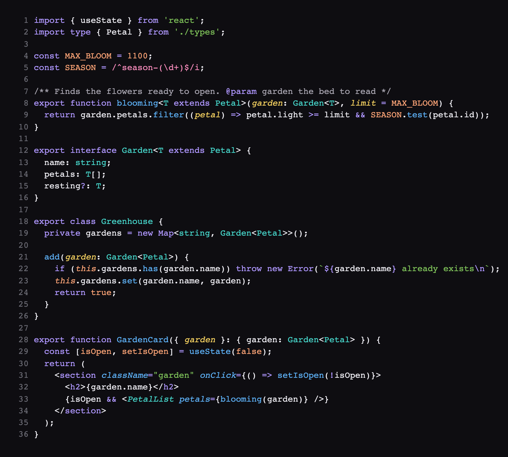
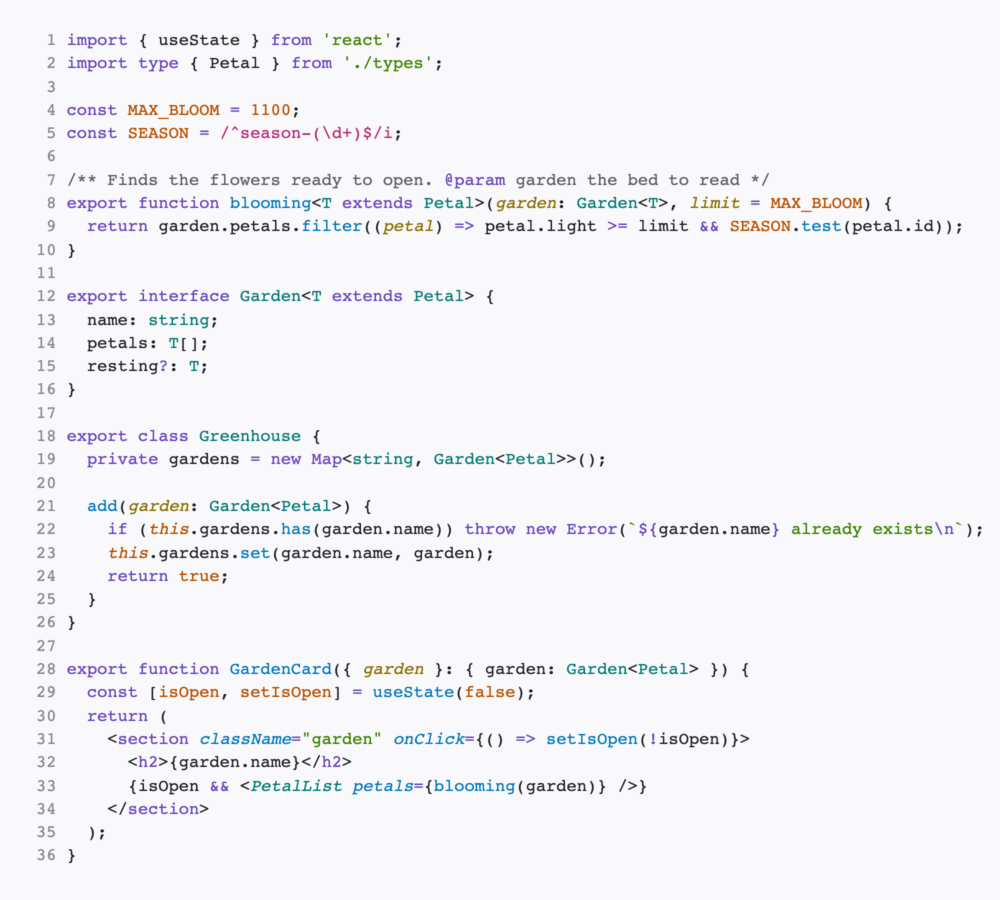

# Lila

Lilac, with the contrast to read code all day. **Lila Dusk** for the dark and **Lila Petal** for the light.

Keywords carry the lilac, so a file has a shape before you read a word of it. Each color has one job: sky is what runs, teal is the shape of data, sage is text, apricot is a fixed value, gold is what was passed in, and rose is a pattern. Errors get their own red, and warnings share apricot.

Pick a Lila variant with `Preferences: Color Theme`. Language server highlighting and rainbow brackets work out of the box.

The full spec, and Lila for other apps, is at [github.com/irwinarruda/lila-theme](https://github.com/irwinarruda/lila-theme).
